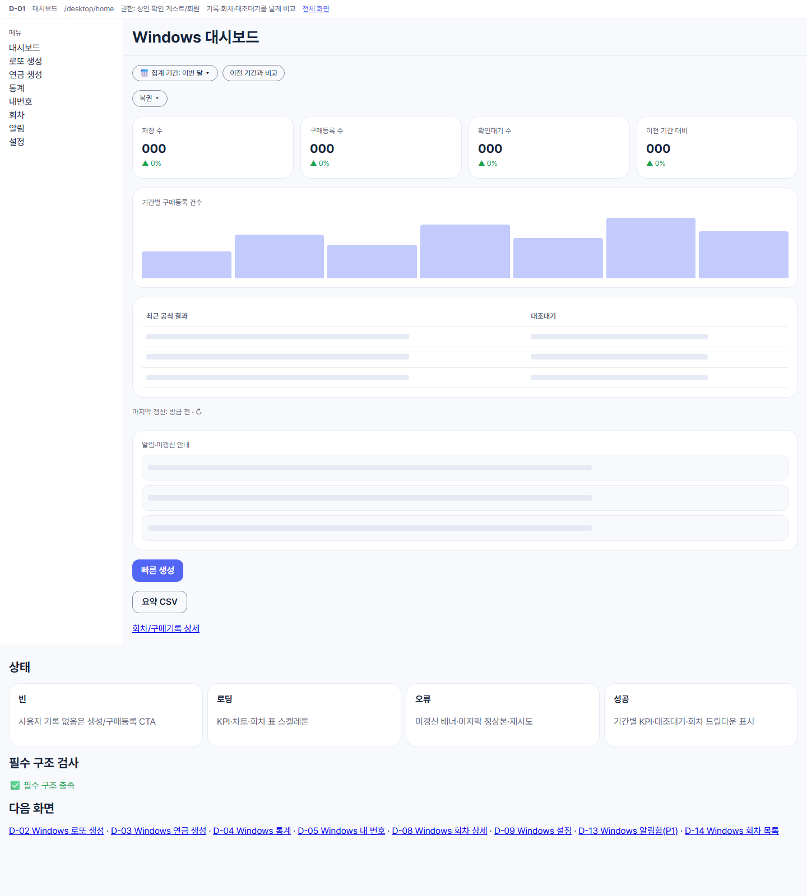
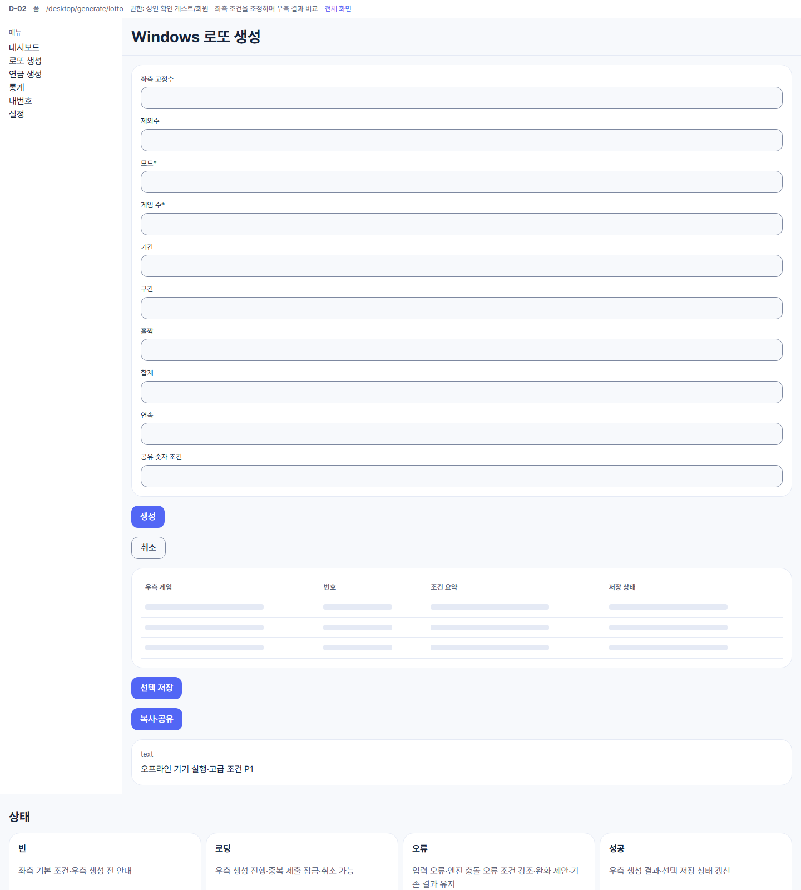
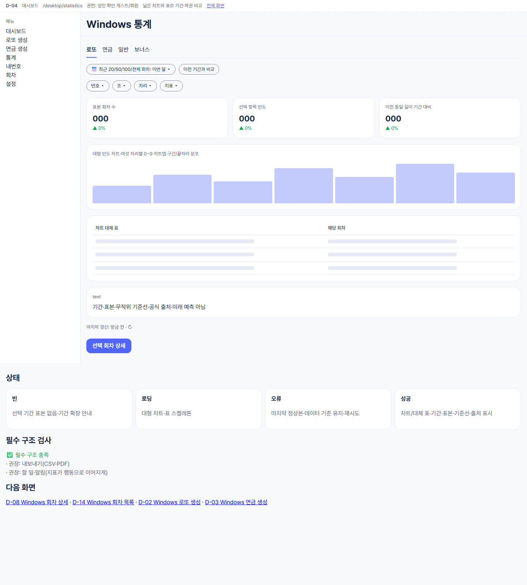
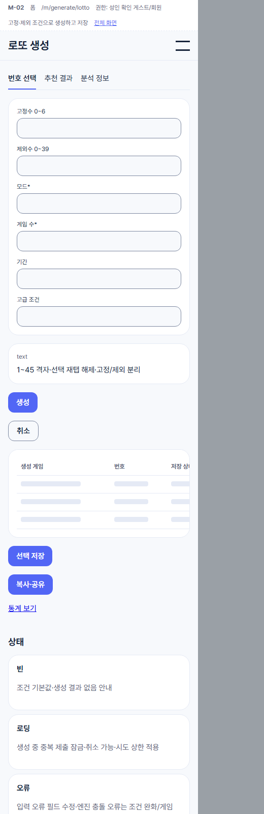
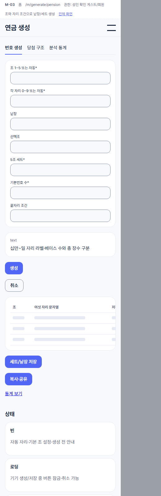
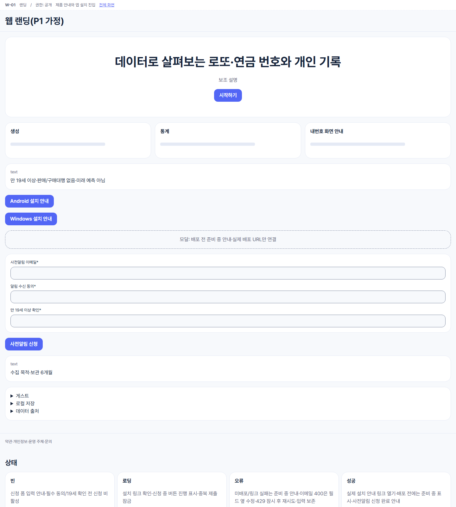

# LOTTO LAB — 로또 6/45 · 연금복권 720+ 번호 생성·통계 앱

만 19세 이상 성인을 위한 **번호 생성 · 공식 회차 조회 · 통계 · 내 번호 관리** 앱입니다. 복권을 판매하거나 구매를 대행하지 않으며, 당첨을 보장하거나 확률을 높여 준다고 표현하지 않습니다.

| 배포 대상 | 방식 | 화면 구조 |
|---|---|---|
| Android · iOS | Capacitor 8 (Android 먼저) | 하단 탭 4개(홈·추천·통계·내번호) — PDF 시안 기준 |
| Windows 설치형 | Tauri 2 (MSI/NSIS) | 대시보드형(좌측 사이드바 + KPI 카드 + 생성 조건/결과 좌우 배치) |
| 웹 | Next.js | 랜딩(사전알림 신청) + 관리자(회차 수집 검토) |

공통: React + Vite + TypeScript, 번호 엔진은 기기에서 실행(오프라인 가능), 백엔드 Supabase(Postgres·RLS·Auth·Edge Functions), 공식 회차 수집은 Python 워커.

## 진행 현황 (2026-11-12 기준)

기획·설계 문서와 저해상도 화면 시안까지 마쳤고, 구현은 아직 시작하지 않았습니다. 다음은 W0(데이터 권리 확인·보안 설정·사전알림 랜딩)입니다.

| 영역 | 현재 상태 |
|---|---|
| 기획 (린 · PRD · 범위) | ✅ 작성 완료 — 린 검증은 **실행 전** |
| UX (화면 34개 · 흐름 16개) | ✅ 작성 완료, 필수 구조 검사 🔴 0 |
| UI (디자인 토큰 · DESIGN.md) | ✅ 초안 완료, 대비 WCAG AA 통과 — 고해상도 시안은 미작성 |
| 기술 설계 (아키텍처 · API 16 · 테이블 12 · ADR 3) | ✅ 작성 완료, 문서 리뷰 1회 반영 |
| 구현 | ⬜ 0 / 36 작업 |
| QA · 출시 | ⬜ 미착수 |

**제한**
- 공식 회차 데이터의 수집·재배포 권리(Q1)를 확인하기 전에는 출시할 수 없습니다.
- 화면 시안의 회차·번호·통계 숫자는 모두 예시입니다.
- iOS 빌드는 macOS가 필요하고, Windows 배포에는 코드 서명 인증서가 필요합니다.

### 작업 진행률

전체 완성도 **약 18%**(가중 추정: 기획·설계 비중 20% × 진행 90% + 구현·QA 비중 80% × 0%)

| 웨이브 | 내용 | 작업 수 | 완료 |
|---|---|---:|---:|
| 문서 | 기획·UX·UI 초안·기술 설계 | — | 90% |
| W0 | 검증·준비 (데이터 권리, 보안 설정, 사전알림 랜딩) | 4 | 0 |
| W1 | 기반 (모노레포, 토큰, DB 스키마·RLS, Capacitor·Tauri 셸) | 6 | 0 |
| W2 | 엔진 (로또·연금 생성, 당첨 판정, 통계, app-core) | 6 | 0 |
| W3 | 모바일 P0 화면 | 7 | 0 |
| W4 | Windows P0 화면 | 5 | 0 |
| W5 | 데이터 (수집 워커, 통계 캐시, 관리자) | 5 | 0 |
| W6 | QA · 배포 빌드 · 출시 점검 | 3 | 0 |

### 구현된 주요 항목
- [x] 기획 문서 체계 `docs/00~05` + ADR 3건
- [x] 화면 사양 `design/spec.json` + 와이어프레임 34개
- [x] 디자인 토큰 `packages/design-tokens/tokens.css`(라이트/다크, 반응형 3구간 폰트)
- [x] 작업 분해 36개 `tasks/`
- [ ] 앱 코드 (아직 없음)

### 다음 개발 단계
- [ ] task-001 공식 회차 데이터 권리 확인 (사용자 확인 필요)
- [ ] task-002 보안 기본 설정 (L2)
- [ ] task-003~004 사전알림 백엔드 + 랜딩 (린 검증)
- [ ] W1 기반 구축 → W2 엔진 → W3·W4 화면

## 개발 환경 (모노레포, task-005)

pnpm workspaces(`apps/*`·`packages/*`) + Turborepo. 내부 패키지는 `@lotto-lab/*`, 모두 `private`, 내부 의존은 `workspace:*`(`.npmrc`의 `link-workspace-packages`로 레지스트리 조회 차단). lockfile은 루트 `pnpm-lock.yaml` 하나.

| 목적 | 명령 |
|---|---|
| 설치 | `pnpm install --frozen-lockfile` |
| 타입 · 린트 · 테스트 · 빌드 | `pnpm typecheck` · `pnpm lint` · `pnpm test` · `pnpm build` (각각 `turbo run …`) |

**도구 버전** (2026-11-12 `npm view` 기준 최신 stable, 정확한 버전 고정): pnpm 10.34.8 · Turborepo 2.11.11 · TypeScript **6.0.3** · ESLint 10.14.0 · typescript-eslint 8.72.2 · @eslint/js 10.0.1 · globals 17.14.0
- TypeScript는 최신 7.0.2가 아닌 6.x 최신으로 워크스페이스 전체를 통일했다: typescript-eslint 8.72.2의 peerDependencies가 `typescript >=4.8.4 <6.1.0`(TS 7 미지원). 지원 버전이 나오면 7로 올린다.
- 린트(루트 `eslint.config.mjs`, 규칙 `lotto-lab/boundaries`): 의존 방향(02#4) 역방향 import, 다른 패키지·앱으로 나가는 상대 경로 import(경로 정규화 후 판정), `@capacitor/*`·`@tauri-apps/*` 직접 import(셸 외)를 정적·동적 import·re-export·require 모두 막는다. `supabase/**`·`services/**`·`**/.next/**` 무시. `pnpm lint`는 먼저 `pnpm check:workspace`(모든 패키지 private·`@lotto-lab/*`, 내부 의존 정확히 `workspace:*`)를 실행한다.
- Turborepo 텔레메트리는 끈다: 각 개발 기기에서 `pnpm exec turbo telemetry disable`을 한 번 실행하거나 `TURBO_TELEMETRY_DISABLED=1`을 설정한다. 원격 캐시는 쓰지 않는다(`turbo.json` `remoteCache.enabled: false`, `turbo login/link` 금지).
- 라이선스(`pnpm licenses list`, 2026-11-12): GPL·AGPL 없음. 새 도구(turbo·eslint·typescript-eslint·@eslint/js·globals)는 MIT, TypeScript는 Apache-2.0. 예외 3건(sharp LGPL 바이너리·lightningcss MPL-2.0·caniuse-lite CC-BY-4.0)은 `apps/web/README.md#라이선스` 판단 유지.
- 메모: `lottery-core`를 Edge Function(Deno)에서 소비하는 방식은 task-012에서 정한다.

## 디자인 시안

### 모바일 (원본 시안 — `LOTTO_LAB_Planning_Design.pdf`)

| 홈 | 로또 생성 | 연금 생성 | 통계 |
|---|---|---|---|
|  |  |  |  |

> 원본 시안의 "과학적으로 추천" 문구는 과대 표현 금지 원칙에 따라 "데이터로 살펴보는"으로 바꿉니다.

### Windows 대시보드 (와이어프레임 — 구조 확인용 저해상도)
| D-01 대시보드 | D-02 로또 생성 | D-04 통계 |
|---|---|---|
|  |  |  |

### 모바일 와이어프레임 · 웹 랜딩
| M-02 로또 생성 | M-03 연금 생성 | W-01 랜딩 |
|---|---|---|
|  |  |  |

전체 34개 화면은 `design/wireframes/index.html`을 브라우저로 열어 3구간(모바일·태블릿·데스크톱)으로 볼 수 있습니다.

## 콘텐츠 바로가기

| 콘텐츠 | 화면 경로 | 기획·명세 문서 | 구현 코드 |
|---|---|---|---|
| 린 검증 · PRD | — | [00_LEAN](docs/00_LEAN.md) · [01_PRD](docs/01_PRD.md) | — |
| 아키텍처 · 결정 기록 | — | [02_ARCHITECTURE](docs/02_ARCHITECTURE.md) · [adr/](docs/adr/) | — |
| 화면 34개 · 흐름 | [wireframes/index.html](design/wireframes/index.html) | [03_SCREENS_UX](docs/03_SCREENS_UX.md) · [benchmark](docs/benchmark.md) | — |
| API · 데이터 | — | [04_API](docs/04_API.md) · [05_DATA_MODEL](docs/05_DATA_MODEL.md) | — |
| 디자인 시스템 | [preview/index.html](design/preview/index.html) | [DESIGN.md](DESIGN.md) · [DESIGN_TOKENS](docs/DESIGN_TOKENS.md) | [tokens.css](packages/design-tokens/tokens.css) |
| 다이어그램 | — | [docs/diagrams/](docs/diagrams/) | — |
| 작업 표 | — | [tasks/README.md](tasks/README.md) | — |
| 원본 v1.0 | — | [LOTTO_LAB_PRD.md](LOTTO_LAB_PRD.md) · [PDF](LOTTO_LAB_Planning_Design.pdf) | — |
