# LOTTO LAB — 로또 6/45 · 연금복권 720+ 번호 생성·통계 앱

만 19세 이상 성인을 위한 **번호 생성 · 공식 회차 조회 · 통계 · 내 번호 관리** 앱입니다. 복권을 판매하거나 구매를 대행하지 않으며, 당첨을 보장하거나 확률을 높여 준다고 표현하지 않습니다.

| 배포 대상 | 방식 | 화면 구조 |
|---|---|---|
| Android · iOS | Capacitor 8 (Android 먼저) | 하단 탭 4개(홈·추천·통계·내번호) |
| Windows 설치형 | Tauri 2 (MSI/NSIS) | 사이드바 + 2열 그리드 — 모바일과 같은 디자인 언어(ADR-0004) |
| 웹 | Next.js 16 | 랜딩(사전알림 신청·이메일 확인) + 관리자(회차 수집 검토, P1) |

공통: React 19 + Vite + TypeScript 6, 번호 엔진은 기기에서 실행(오프라인 가능), 백엔드 Supabase(Postgres·RLS·Edge Functions), 공식 회차 수집은 Python 워커(W5).

## 진행 현황 (2026-11-12 기준)

기반·사전알림 웹·**모바일 P0 화면 전체**가 끝났고, **Windows 화면을 만드는 중**(W4)입니다. 작업 브랜치 `dev/fortune-and-w0`(PR #3, PR #1·#2 포함).

| 영역 | 현재 상태 |
|---|---|
| 기획 · UX · 디자인 | ✅ 문서·화면 41개·PC 시안 확정, 운세·사주 번호(ADR-0005)·광고(ADR-0006) 기획 포함 |
| DB · 보안 | ✅ 공개·사용자 스키마 RLS·열 권한(pgTAP 548건), 보안 L2 설정·Dependabot |
| 사전알림 웹 | ✅ 랜딩 + 이메일 이중 확인 서버(Edge Function, Deno 테스트 43건) |
| 엔진 · 통계 · 앱 공통 로직 | ✅ 로또·연금 생성(고정·제외·자리 고정·조 확장)·당첨 판정·통계 9종·로컬 저장·공개 읽기 캐시 |
| 앱 셸 | ✅ Android 디버그 APK · Windows 디버그 exe 빌드, 릴리스 점검 스크립트 |
| 모바일 화면 | ✅ 온보딩·홈·추천·로또/연금 생성·통계·회차·내 번호·당첨 확인·구매 등록·설정(다크 모드) |
| Windows 화면 | 🔄 온보딩·대시보드·설정·로또/연금 생성 완료 / 통계·회차·내 번호 표·CSV·구매 등록 남음 |
| 회차 수집 워커 · 출시 | ⬜ 미착수 |

**제한**
- 공식 회차 데이터의 수집·재배포 권리(task-001)를 확인하기 전에는 출시할 수 없습니다(수집 워커 W5도 그 뒤 착수).
- 로컬 DB의 회차는 합성(가짜) 데이터이고, 화면 시안의 숫자는 예시입니다.
- iOS 빌드는 macOS가 필요하고, Windows 배포에는 코드 서명 인증서가 필요합니다.

### 작업 진행률

출시 버전(P0, W0~W6) **27 / 40 완료(약 68%)** · 전체(P1 포함) 27 / 49. 무거운 기반 작업이 끝나 남은 대부분은 만들어 둔 부품을 조립하는 화면 작업입니다.

| 웨이브 | 내용 | 완료 / 작업 |
|---|---|---:|
| W0 | 검증·준비 (데이터 권리, 보안, 사전알림 서버·이메일 확인·랜딩) | 4 / 5 |
| W1 | 기반 (모노레포, UI 블록·오버레이, PC 시안, DB 스키마, 앱 셸) | 8 / 8 |
| W2 | 엔진 (타입·검증, 판정, 로또·연금 생성, 통계, app-core) | 6 / 6 |
| W3 | 모바일 P0 화면 | 7 / 7 |
| W4 | Windows P0 화면 | 2 / 5 |
| W5 | 데이터 (수집 워커, 통계 캐시, 관리자) | 0 / 5 |
| W6 | QA · 배포 빌드 · 출시 점검 · 사전알림 발송 | 0 / 4 |
| W7 (P1) | 운세·사주 번호, 로그인, 광고, 만세력 | 0 / 9 (기획 완료, task-037 착수 결정) |

### 구현된 주요 항목
- [x] 사전알림: `supabase/functions/waitlist`·`waitlist-confirm`(Turnstile·레이트리밋·이중 확인), `apps/web` 랜딩·확인 화면
- [x] DB: `supabase/migrations` 4개(사전알림·공개 회차·사용자 데이터), RLS·열 단위 권한·상태 전환 트리거
- [x] 모노레포: pnpm workspaces + Turborepo, 의존 방향 lint(`lotto-lab/boundaries`), pnpm catalog
- [x] `packages/types`·`validation`(DB와 판정 동치 벡터) · `lottery-core`(판정·Rng) · `lotto-engine` · `pension-engine` · `statistics`(독립 구현 골든) · `app-core`
- [x] `packages/ui`: 공유 블록·번호 공·그리드·오버레이(토스트·스낵바·얼럿·시트·메뉴·툴팁)·모바일 화면 M-01~M-05·M-07~M-09·M-11·M-12·M-15·M-16, Windows D-01·D-02·D-03·D-09·D-11
- [x] `apps/mobile`(Capacitor 8) · `apps/desktop`(Tauri 2) 셸 — app-core 주입·보안 설정·릴리스 점검
- [ ] Windows 화면: D-04 통계·D-14/D-08 회차·D-05 내 번호 표+CSV·D-06/D-07 상세·구매 등록
- [ ] 회차 수집 워커·관리자, 출시 점검

### 다음 개발 단계
- [ ] task-026·027·028 Windows 나머지 화면 — 중단 지점 코드는 `wip/task-026-028-partial` 브랜치에 보관(리뷰 전)
- [ ] W5 회차 수집 워커(task-001 확인 후) → W6 출시 점검
- 사용자 확인 필요: task-001 데이터 권리, 운영 메일 서비스·문의처, GitHub Code security 설정, 연금 등위+보너스 동시 당첨 규정, 정식 앱 아이콘

## 개발 환경 (모노레포, task-005)

pnpm workspaces(`apps/*`·`packages/*`) + Turborepo. 내부 패키지는 `@lotto-lab/*`, 모두 `private`, 내부 의존은 `workspace:*`(`.npmrc`의 `link-workspace-packages`로 레지스트리 조회 차단). lockfile은 루트 `pnpm-lock.yaml` 하나.

| 목적 | 명령 |
|---|---|
| 설치 | `pnpm install --frozen-lockfile` |
| 타입 · 린트 · 테스트 · 빌드 | `pnpm typecheck` · `pnpm lint` · `pnpm test` · `pnpm build` (각각 `turbo run …`) |

**도구 버전** (2026-11-12 `npm view` 기준 최신 stable, 정확한 버전 고정): pnpm 10.34.8 · Turborepo 2.11.11 · TypeScript **6.0.3** · ESLint 10.14.0 · typescript-eslint 8.72.2 · @eslint/js 10.0.1 · globals 17.14.0
- TypeScript는 최신 7.0.2가 아닌 6.x 최신으로 워크스페이스 전체를 통일했다: typescript-eslint 8.72.2의 peerDependencies가 `typescript >=4.8.4 <6.1.0`(TS 7 미지원). 지원 버전이 나오면 7로 올린다.
- 린트(루트 `eslint.config.mjs`, 규칙 `lotto-lab/boundaries`): 의존 방향(02#4) 역방향 import, 다른 패키지·앱으로 나가는 상대 경로 import(경로 정규화 후 판정), `@capacitor/*`·`@tauri-apps/*` 직접 import(셸 외)를 정적·동적 import·re-export·require 모두 막는다. `supabase/**`·`services/**`·`**/.next/**` 무시. `pnpm lint`는 먼저 `pnpm check:workspace`(모든 패키지 private·`@lotto-lab/*`, 내부 의존 정확히 `workspace:*`)를 실행한다.
- Turborepo 텔레메트리는 끈다: 각 개발 기기에서 `pnpm exec turbo telemetry disable`을 한 번 실행하거나 `TURBO_TELEMETRY_DISABLED=1`을 설정한다. 원격 캐시는 쓰지 않는다(`turbo.json` `remoteCache.enabled: false`, `turbo login/link` 금지).
- 라이선스(`pnpm licenses list`, 2026-11-12): GPL·AGPL 없음. 새 도구(turbo·eslint·typescript-eslint·@eslint/js·globals)는 MIT, TypeScript는 Apache-2.0. 예외 3건(sharp LGPL 바이너리·lightningcss MPL-2.0·caniuse-lite CC-BY-4.0)은 `apps/web/README.md#라이선스` 판단 유지.
- 메모: `lottery-core`를 Edge Function(Deno)에서 소비하는 방식은 task-012에서 정한다.

## 앱 실행하기 (Tauri · Capacitor)

### 0. 공통 준비 (처음 한 번) — 명령은 Git Bash 기준(PowerShell은 `cp` 대신 `copy`)
| 준비물 | 확인 명령 | 용도 |
|---|---|---|
| Node 20.9+ · pnpm 10.34.8 | `node -v` · `pnpm -v` | 전체 |
| Docker Desktop(실행 중) | `docker info` | 로컬 Supabase |
| JDK 21 · Android SDK(platform 36, `ANDROID_HOME` 설정) | `java -version` · `echo %ANDROID_HOME%` | 모바일(Capacitor) |
| Rust stable(MSVC) · Visual Studio Build Tools(C++) · WebView2 런타임 | `rustc -V` | Windows(Tauri) |

```bash
pnpm install --frozen-lockfile          # 저장소 루트에서
npx supabase@3.1.0 start                # 로컬 Supabase(DB·API) 실행 — API http://127.0.0.1:54521
npx supabase@3.1.0 status               # 출력의 Publishable key(sb_publishable_...)를 복사
```
각 앱 폴더에서 `.env.example`을 `.env.local`로 복사하고 `VITE_SUPABASE_PUBLISHABLE_KEY`에 위 키를 넣는다(`.env.local`은 커밋되지 않음). 서버 키(`sb_secret_...`)는 절대 넣지 않는다. 키 없이 실행하면 앱은 뜨고 "서버 연결 설정이 없습니다" 안내만 보인다. 로컬 DB에는 합성(가짜) 회차 시드가 들어 있다.

### 1. Windows 앱 (Tauri 2) — `apps/desktop`
```bash
cd apps/desktop
cp .env.example .env.local              # 키 입력
pnpm tauri dev                          # 개발 실행: Vite(127.0.0.1:5174) + 앱 창이 뜸, 코드 저장 시 자동 반영
pnpm tauri build --debug --no-bundle    # 디버그 실행 파일: src-tauri/target/debug/lotto-lab-desktop.exe
```
- 첫 `tauri dev`는 Rust 크레이트를 내려받아 빌드하므로 몇 분 걸린다.
- 디버그 exe는 운영 CSP를 써서 로컬 Supabase에 연결하지 않는다(화면 확인용). 데이터까지 보려면 `pnpm tauri dev`를 쓴다.
- 배포용 설치본(MSI·NSIS)은 `pnpm build:release` — 운영 env 필요, 절차는 [apps/desktop/README.md](apps/desktop/README.md#릴리스-빌드).

### 2. 모바일 앱 (Capacitor 8, Android) — `apps/mobile`
```bash
cd apps/mobile
cp .env.example .env.local              # 키 입력
pnpm dev                                # 브라우저 미리보기: http://127.0.0.1:5173 (개발자 도구에서 휴대폰 크기로 확인)
pnpm build && pnpm exec cap sync android        # 웹 빌드를 Android 프로젝트로 복사
pnpm exec cap run android               # 연결된 기기·에뮬레이터에 설치·실행(기기 선택 목록이 뜸)
pnpm exec cap open android              # 또는 Android Studio로 열어 ▶ 실행
cd android && gradlew.bat assembleDebug # APK만 만들기: android/app/build/outputs/apk/debug/app-debug.apk
```
- 기기·에뮬레이터에서는 로컬 Supabase에 연결되지 않는다: 앱이 보안상 평문 http를 막아 두었고(cleartext false), 기기 안의 `127.0.0.1`은 PC가 아니라 기기 자신이다. 그래서 기기 실행은 **화면·동작 확인용**이고, 로컬 데이터 연동 확인은 `pnpm dev`(브라우저)에서 한다. 실제 데이터 연동은 운영(https) Supabase가 준비된 뒤 확인한다.
- `CAP_SERVER_URL`로 라이브 리로드를 쓴 뒤에는 반드시 값 없이 `cap sync android`를 다시 실행한다(남아 있으면 릴리스 점검이 실패).
- 배포용 빌드는 `pnpm build:release` — 운영 env 필요, 절차는 [apps/mobile/README.md](apps/mobile/README.md#릴리스-빌드).

### 3. 웹 랜딩 (Next.js) — `apps/web`
```bash
pnpm --filter @lotto-lab/web dev        # http://localhost:3000
```

### 끄기
`Ctrl+C`로 개발 서버를 멈추고, `npx supabase@3.1.0 stop`으로 로컬 Supabase를 끈다.

## 디자인 시안

### 모바일 (원본 시안 — `LOTTO_LAB_Planning_Design.pdf`)
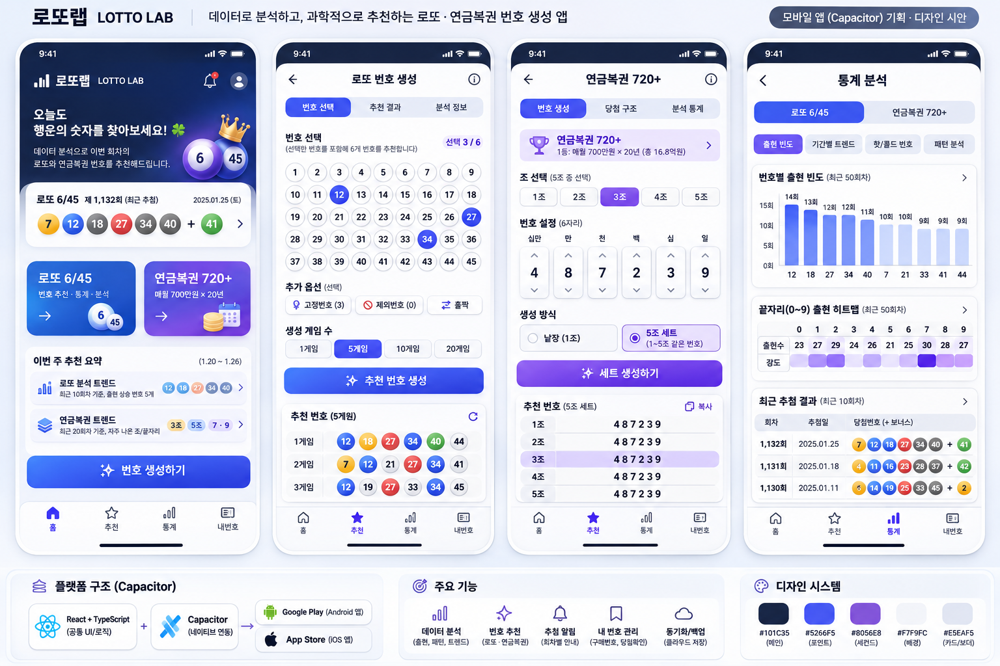

| 홈 | 로또 생성 | 연금 생성 | 통계 |
|---|---|---|---|
| 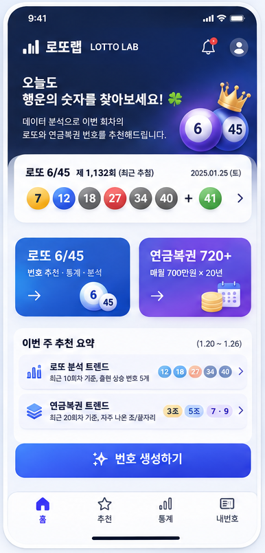 | 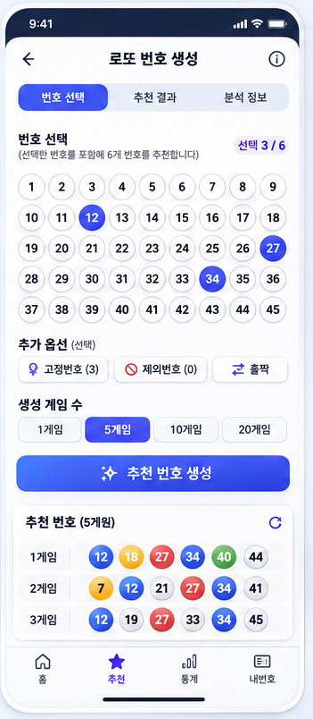 | 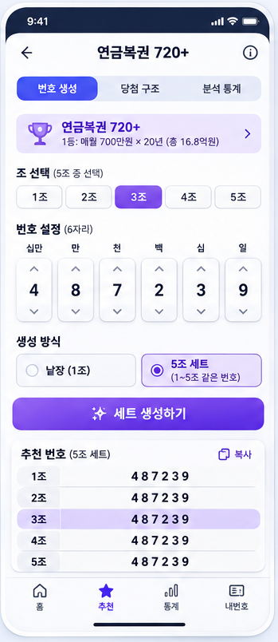 | 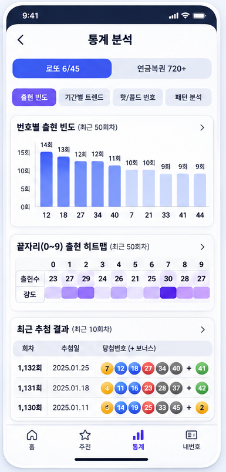 |

> 원본 시안의 "과학적으로 추천" 문구는 과대 표현 금지 원칙에 따라 "데이터로 살펴보는"으로 바꿉니다.

### 구현된 화면 (실제 앱 캡처 — 로컬 DB 없이 찍은 화면은 오류·빈 상태 포함)
| M-05 온보딩 | M-01 홈 | M-02 로또 생성 | M-03 연금 생성 |
|---|---|---|---|
|  |  | 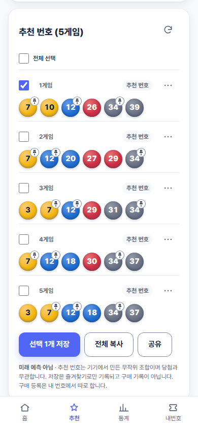 | 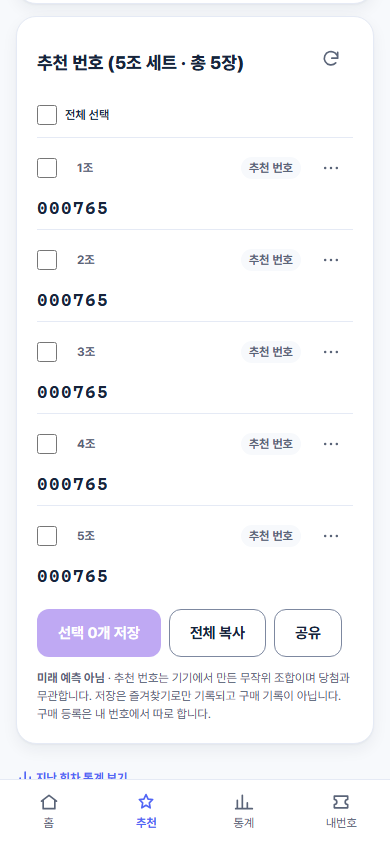 |

| M-04 통계 | M-11 회차 상세 | M-07 내 번호 | M-12 설정 |
|---|---|---|---|
| 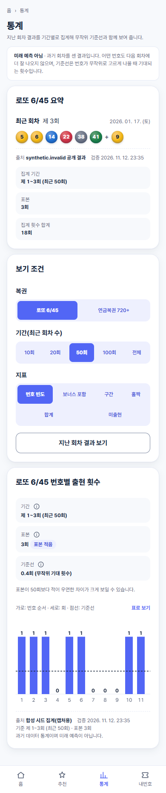 | 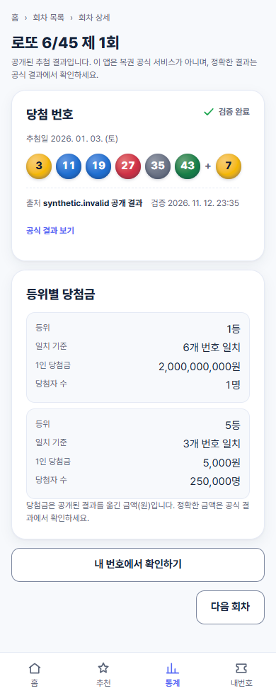 | 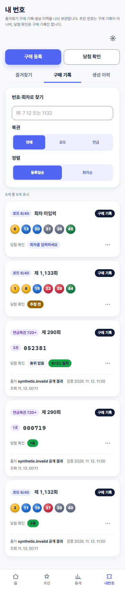 | 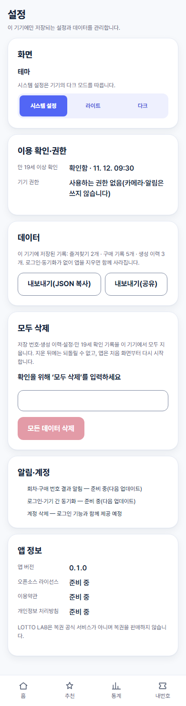 |

| Windows D-01 대시보드 (구현) | Windows D-02 로또 생성 (구현) |
|---|---|
| 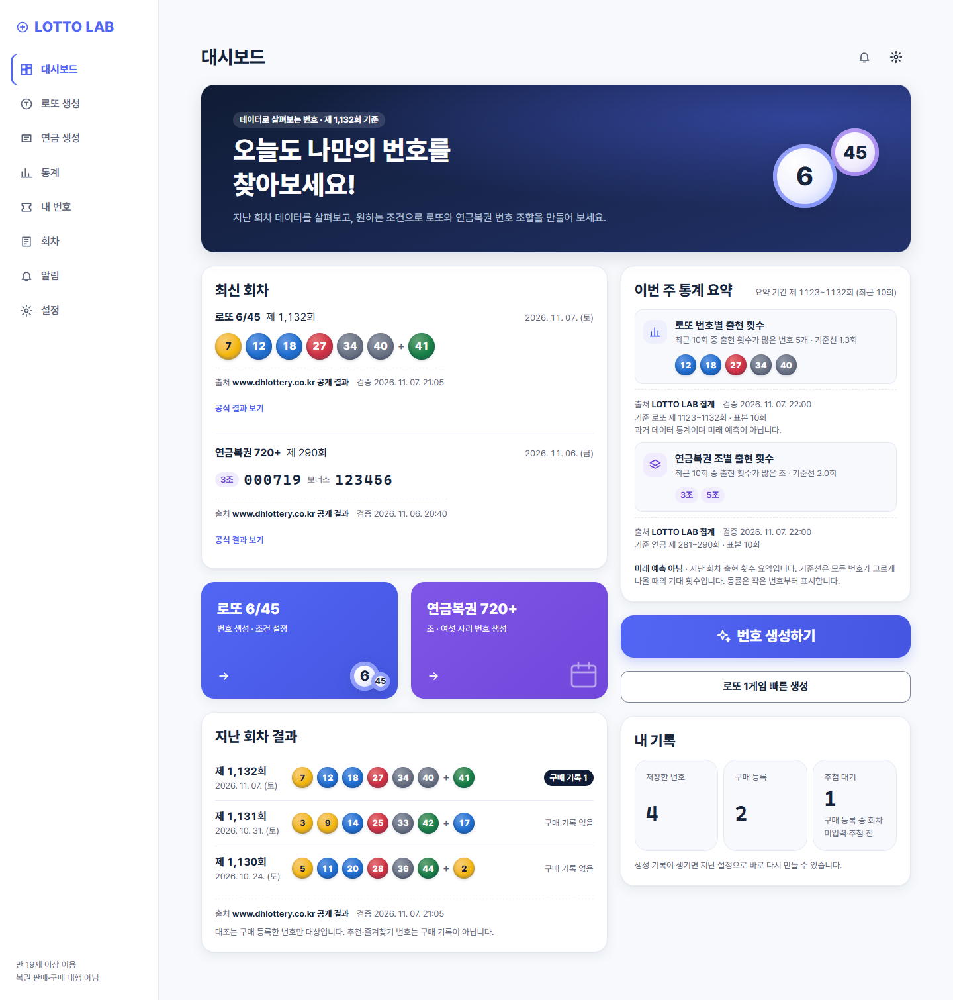 | 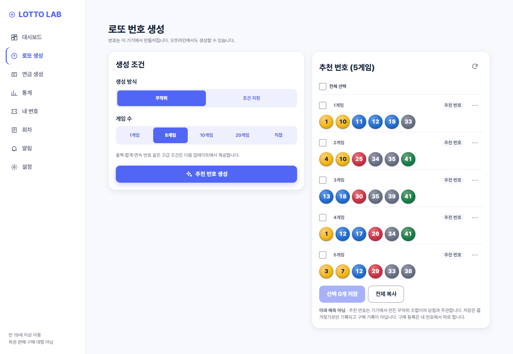 |

### Windows · 웹
| Windows 홈 시안 (확정, ADR-0004) | Windows 로또 생성 시안 | 웹 랜딩 W-01 (구현) |
|---|---|---|
| 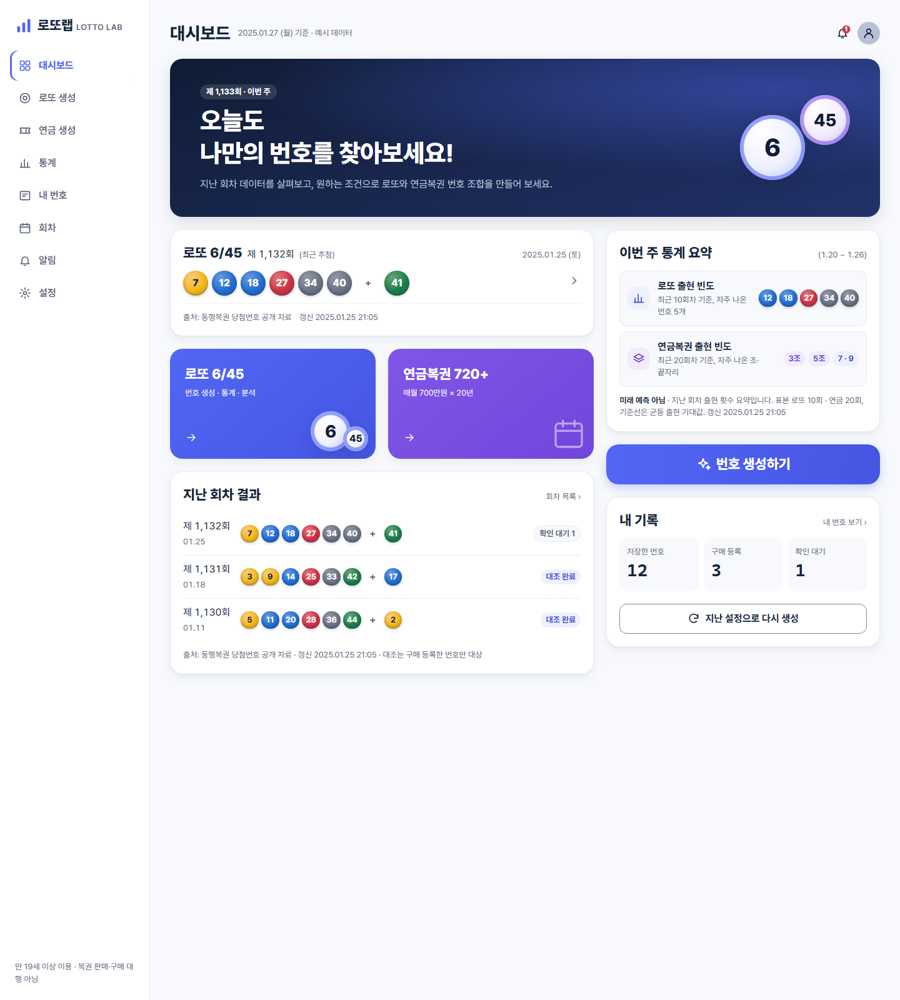 | 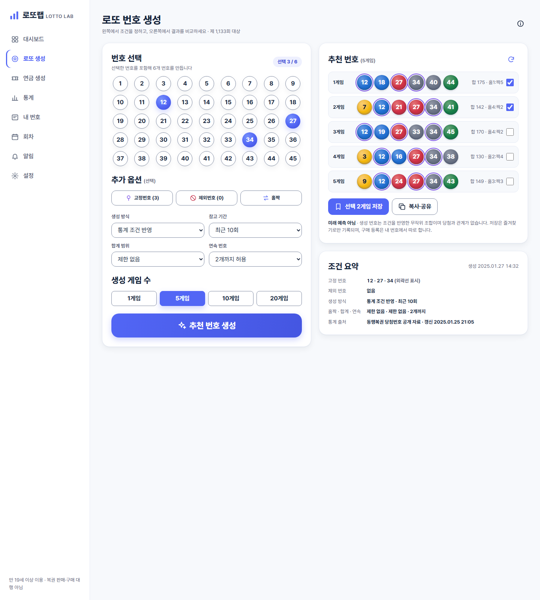 | 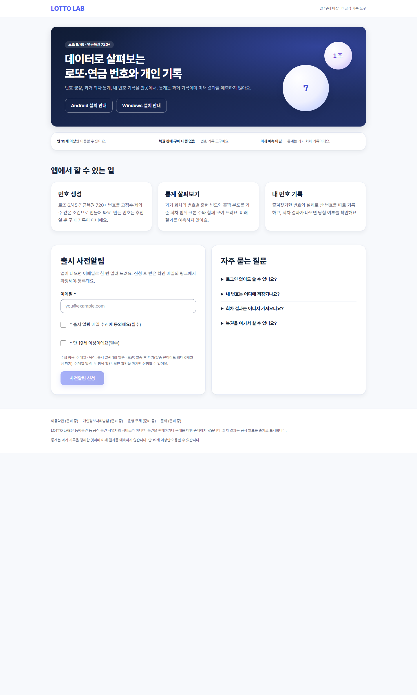 |

Windows 시안 원본은 `design/reference/d-home.html`·`d-lotto.html`(로컬 서버로 열기). 전체 41개 화면 와이어프레임은 `design/wireframes/index.html`을 브라우저로 열어 3구간으로 볼 수 있습니다.

## 콘텐츠 바로가기

| 콘텐츠 | 화면 경로 | 기획·명세 문서 | 구현 코드 |
|---|---|---|---|
| 린 검증 · PRD | — | [00_LEAN](docs/00_LEAN.md) · [01_PRD](docs/01_PRD.md) | — |
| 아키텍처 · 결정 기록 | — | [02_ARCHITECTURE](docs/02_ARCHITECTURE.md) · [adr/](docs/adr/) | — |
| 화면 41개 · 흐름 | [wireframes/index.html](design/wireframes/index.html) | [03_SCREENS_UX](docs/03_SCREENS_UX.md) · [benchmark](docs/benchmark.md) | [packages/ui/src/screens](packages/ui/src/screens) |
| API · 데이터 | — | [04_API](docs/04_API.md) · [05_DATA_MODEL](docs/05_DATA_MODEL.md) | [supabase/](supabase/) · [app-core](packages/app-core) |
| 디자인 시스템 | [preview/index.html](design/preview/index.html) | [DESIGN.md](DESIGN.md) · [DESIGN_TOKENS](docs/DESIGN_TOKENS.md) | [tokens.css](packages/design-tokens/tokens.css) |
| 번호 엔진 · 통계 | — | [task-013](tasks/task-013.md) · [task-014](tasks/task-014.md) · [task-015](tasks/task-015.md) | [lotto-engine](packages/lotto-engine) · [pension-engine](packages/pension-engine) · [statistics](packages/statistics) |
| 앱 셸 | — | [02_ARCHITECTURE#5](docs/02_ARCHITECTURE.md) | [apps/mobile](apps/mobile) · [apps/desktop](apps/desktop) · [apps/web](apps/web) |
| 다이어그램 | — | [docs/diagrams/](docs/diagrams/) | — |
| 작업 표 | — | [tasks/README.md](tasks/README.md) | — |
| 원본 v1.0 | — | [LOTTO_LAB_PRD.md](LOTTO_LAB_PRD.md) · [PDF](LOTTO_LAB_Planning_Design.pdf) | — |
